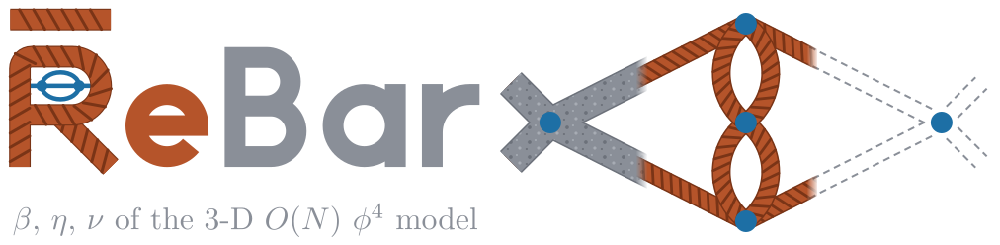

ReBar computes the renormalisation-group functions $\beta$, $\eta$ and $\nu$ of the three-dimensional $O(N)$ $\phi^4$
model in fixed dimension (the massive zero-momentum scheme), to tenth order in the coupling (eleventh for $\beta$).
These series, once resummed, give the critical exponents of the $O(N)$ universality classes directly in three
dimensions. The classes include the Ising model, the XY model, the Heisenberg model and polymers. The method is
independent of the $\varepsilon$ expansion, the conformal bootstrap and lattice simulations. How accurate the exponents
are depends on how many orders are known and on how precise the highest ones are. The series were taken to six and
seven loops by Baker, Nickel, Meiron and collaborators ([1976](https://doi.org/10.1103/PhysRevLett.36.1351),
[1978](https://doi.org/10.1103/PhysRevB.17.1365) and unpublished work to 1991), and to $\bar u^8$ by Phi4tools
(Sberveglieri and Spada, [JHEP 05 (2024) 073](https://doi.org/10.1007/JHEP05%282024%29073),
[arXiv:2311.12576](https://arxiv.org/abs/2311.12576)). ReBar adds the ninth and tenth orders of all three functions and the eleventh of $\beta$, and makes the eighth more precise. Every
coefficient is a sum of finite $\bar R$-subtracted parametric Feynman integrals, sampled graph by graph with tropical
Monte Carlo on GPUs. The graphs come from `topologies`, a generator that derives from the one used by the author and Riccardo Guida
to produce the results described in [J. Stat. Mech. (2006) P02007](https://doi.org/10.1088/1742-5468/2006/02/P02007)
([cond-mat/0512222](https://arxiv.org/abs/cond-mat/0512222)).

**Status (29 October 2026): initial public release**, version 0.4.3, archived at Zenodo
([doi:10.5281/zenodo.23750242](https://doi.org/10.5281/zenodo.23750242)). The known orders, through seven loops, have
been recomputed on GPUs and compared with Phi4tools; the ninth and tenth orders of all three functions, and the
eleventh of $\beta$, are in. **The paper is [arXiv:2610.39307](https://arxiv.org/abs/2610.39307)** (its build from
these sources: [PDF](paper/main.pdf)).

## Results so far

Order sums at $N = 1$ (Ising), and the coefficients they give in the coupling $\bar u = (N+8)\,u/6$, where $u = g/8\pi$
($\bar u$ is Phi4tools' $\tilde u$):

| Sum | Value | Gives | Previously |
|---|---|---|---|
| $B_8$ | 30.469859(76) | coefficient of $\bar u^9$ in $\beta$: −2.366420(6) | unknown |
| $H_8$ | 0.03750774(17) | coefficient of $\bar u^8$ in $\eta$: 0.002910571(13) | about 120 times less precise |
| $C_8$ | 2.070192(21) | coefficient of $\bar u^8$ in $\nu$: −0.0317869(4) | about 4 times less precise |
| $H_9$ | 0.09845268(98) | coefficient of $\bar u^9$ in $\eta$: −0.00510339(5) | unknown |
| $C_9$ | 5.859068(58) | coefficient of $\bar u^9$ in $\nu$: 0.0613316(8) | unknown |
| $B_9$ | 92.27709(91) | coefficient of $\bar u^{10}$ in $\beta$: 4.78115(5) | unknown |
| $H_{10}$ | 0.2879452(41) | coefficient of $\bar u^{10}$ in $\eta$: 0.00995358(14) | unknown |
| $C_{10}$ | 17.95856(52) | coefficient of $\bar u^{10}$ in $\nu$: −0.127571(5) | unknown |
| $B_{10}$ | 300.5548(35) | coefficient of $\bar u^{11}$ in $\beta$: −10.38718(12) | unknown |
| $B_7$, $H_7$, $C_7$ | 10.917628(31), 0.014550034(71), 0.8011143(39) | the seventh order of $\beta$, $\eta$, $\nu$ | about 1.5, 11 and 3 times less precise |

They come from the runs of 14–18 October 2026 on H200 GPUs; the errors are one standard deviation, statistical,
and the replica ensembles at six and seven loops and the comparison of each merged run with the pool of the runs before
it confirm them (checks N7 and N5). The paper's Supplemental Material is this repository:
[`SUPPLEMENTAL.md`](SUPPLEMENTAL.md) says where each of its items is, among them the coefficients at $N = 0$ to $4$
with their covariance (`series/generated/`).
The pooled per-graph statistics behind every number are in [`ledger/`](ledger/), the reports of the runs in
[`results/`](results/README.md), and the paper that presents them is [arXiv:2610.39307](https://arxiv.org/abs/2610.39307)
([PDF](paper/main.pdf)). Normalisations are in [`doc/CONVENTIONS.md`](doc/CONVENTIONS.md).

## How it works

- **Graphs.** `topologies`, the graph generator, which derives from the one of the author's
  ([J. Stat. Mech. (2006) P02007](https://doi.org/10.1088/1742-5468/2006/02/P02007)) and grows the graphs by vertex insertion, produces the 1PI $\Gamma^{(2)}$ and $\Gamma^{(4)}$ graphs: 26 540 four-point graphs at eight loops and 1 593 254 at ten, and 9 184 two-point graphs
  without self-loops at nine and 59 614 at ten. Every list is checked against exact zero-dimensional sum rules ([`graphs/`](graphs/README.md)).
- **$\bar R$ at zero momentum.** Through the [Callan](https://doi.org/10.1103/PhysRevD.2.1541)–[Symanzik](https://doi.org/10.1007/BF01649434) equation, every order of $\beta$, $\eta$, $\eta_{\phi^2}$ and $\nu$
  is a sum of zero-momentum integrals. [Zimmermann's forest formula](https://doi.org/10.1007/BF01645676) subtracts each integrand ($\bar R$), so each integral
  is finite by itself: there is no series reversion and no large cancellation between graphs. The forest terms are
  expanded into products of Kirchhoff polynomials of 2-connected blocks, and terms that cancel exactly drop out
  algebraically.
- **One kernel for every graph.** The host turns each graph into a small program of such blocks. A single generic
  kernel evaluates any such program in double precision. Its source is shared by CPUs (OpenMP) and NVIDIA GPUs
  (CUDA), and it draws [Philox](https://doi.org/10.1145/2063384.2063405) counter-based random numbers with one key per graph ([`integrator/`](integrator/README.md)).
- **Tropical sampling.** Points are drawn [Hepp sector](https://doi.org/10.1007/BF01773358) by Hepp sector from a forest-aware tropical
  density ([Borinsky's algorithm](https://doi.org/10.4171/aihpd/158)). The samples of an order are shared among its graphs by [Neyman allocation](https://doi.org/10.2307/2342192) on the measured device time.
- **A pooled ledger.** The per-graph statistics of every run are kept and pooled exactly, since runs with different
  seeds are independent. The coefficient tables, and the paper's, are regenerated from the pool
  ([`doc/LEDGER.md`](doc/LEDGER.md)).

## Layout

| Directory | What it holds |
|---|---|
| [`graphs/`](graphs/README.md) | The graph generator `topologies` (2026, derived from the 2003 one) for any list of vertex valences. The reference lists of 1PI $\Gamma^{(2)}$ and $\Gamma^{(4)}$ graphs to ten loops ($\Gamma^{(2)}$ without self-loops also at eleven), and their zero-dimensional checks |
| [`integrator/`](integrator/README.md) | `rebar_cpu` and `rebar_gpu`: the forest-subtracted integrands, the tropical sampler, the CPU and CUDA back-ends, the production drivers, and the validation against exact values and Phi4tools |
| [`series/`](series/) | The ledger tools: `rebar-refine.sh` produces a contribution and `rebar-merge.py` validates and pools it. From the ledger, `make -C series` derives the order sums $B_L$, $H_L$, $C_L$ as polynomials in $N$, the coefficients of $\beta$, $\eta$, $\eta_{\phi^2}$ and $\nu$ with their correlated errors, and the paper's tables |
| [`ledger/`](ledger/) | The pooled Monte Carlo statistics of every graph class. `orders.json` holds the per-order sums, errors and status, and a manifest entry for every run. `<kind><L>/weights-*.tsv` holds the weight polynomials as exact fractions, `<kind><L>/stats-*.tsv` the per-class statistics merged over all the runs, whose size does not grow with their number, and `seeds.json` every seed used. The runs themselves are archived outside git, as received (`ledger-archive/`, to be deposited on Zenodo), and the ledger is rebuilt from them bit for bit ([`doc/LEDGER.md`](doc/LEDGER.md)) |
| [`results/`](results/README.md) | What the computing campaigns produced besides the per-class statistics: dated snapshots of the series and tables that `make -C series` derives from the ledger (`coefficients/`), and the reference data and inputs of the checks (`checks/`). The campaigns' reports, logs and environment records are kept outside the public repository |
| [`checks/`](checks/) | The reproducibility checks: one script per claim of the paper (G1–G5 graphs, I1–I4 integrands, N1–N8 numerics, S1–S5 series), run by `make -C checks` |
| `paper/` | The sources of [the paper](https://arxiv.org/abs/2610.39307) and its [PDF](paper/main.pdf); its numbers are generated from the ledger and its claims cite their checks |
| [`releases/`](releases/README.md), [`tools/`](tools/) | The versioning and packaging of the binary releases, and the scripts that build and publish them |
| [`doc/`](doc/) | [`CONVENTIONS.md`](doc/CONVENTIONS.md) (normalisations and relations), [`LEDGER.md`](doc/LEDGER.md) (the ledger: format, pooling, validation, refinement) and `logo/` (the banner and the icon) |

## Quick start

    make -C graphs check        # build the generator, regenerate the lists through 8 loops and check them (a few minutes)
    make -C integrator          # bin/rebar_cpu, and bin/rebar_gpu when a CUDA toolkit is found
    make -C integrator VARIANTS=e20   # the 20-line build: bin/rebar_cpu-e20, and bin/rebar_gpu-e20 with CUDA
    series/rebar-refine.sh --bin integrator/bin/rebar_gpu-e20 --seconds 14400   # four hours on the order that needs it most

`series/rebar-refine.sh --help` lists its options, among them the order to refine; `--bin integrator/bin/rebar_cpu-e20`
runs on the CPU. The order that needs it most is now one of ten loops, which needs the 20-line build. The orders
up to nine loops also run with `bin/rebar_gpu` or `bin/rebar_cpu`, which call their 18-line variant by themselves when
needed ([`integrator/README.md`](integrator/README.md)).

Binary releases for x86-64 Linux (the integrator for CPUs and for NVIDIA GPUs, the generator and the graph lists)
are attached to the [releases](https://github.com/PaoloRibeca/ReBar/releases) of this repository;
[`releases/README.md`](releases/README.md) says how they are made and versioned.

Requirements for building from source:

- Linux, GNU make, bash, and a C++17 compiler with OpenMP (g++ 7 to 16 tested).
- Python ≥ 3.6, standard library only.
- For GPUs, an NVIDIA driver and CUDA 12.x. The default target is sm_90 (H100, H200); `CUDA_ARCH="80 90"` adds A100.
  The production drivers, the self-tests and the troubleshooting notes are in
  [`integrator/README.md`](integrator/README.md).

## Reproducing the checks

Every claim of the paper that a script can verify cites its check, as "[check G2]", and the paper's appendix
"Reproducibility" lists them. The scripts are in [`checks/`](checks/), one per claim:

    make -C checks              # run them all and write checks/REPORT.md
    make -C checks quick        # only the checks that take about a minute or less
    python3 checks/run.py G2    # one check

They cover the graph lists and their weights (G1–G5: canonical forms and counts, the zero-dimensional sum rules, the
comparison with Phi4tools' lists and with the weights of the 2003 code), the integrands (I1–I4: the forest expansion
against a 100-digit evaluation, the vanishing graphs, the [Whitney twins](https://doi.org/10.2307/2371127), the class cache), the numerics (N1–N8: the
Philox known answers, GPUs against the CPU, the exact two-loop sums, the agreement with Phi4tools at three to seven
loops, the consistency of independent contributions to a class, the absence of round-off bias, the scatter of
independent replicas at six and seven loops, the round-off of the classes of $H_4$) and the series (S1–S5: the Callan–Symanzik algebra,
the regeneration of every generated number of the paper from the ledger, the large-order test, the second route
through the bare vertex functions at the ninth and tenth orders, the large-$N$ limit). Each prints the
numbers it obtains and ends with `PASS` or `FAIL`, or with `SKIP` when the machine lacks what it needs; it then
verifies the stored outputs of the run that had it, in [`results/`](results/README.md).

They need what the quick start needs: Python ≥ 3.6 with the standard library, the graph tools and the CPU build of
the integrator. A GPU is needed only for the live part of N2, the Python package `mpmath` only for the live part of
I1, and the run archive (`ledger-archive/`) only for the replay of N5.

## Contributing computing time

ReBar is designed so that anyone can add to the computation, in the spirit of [SETI@home](https://setiathome.berkeley.edu/):

1. **Run.** On a machine with a GPU, or with only a CPU, run `series/rebar-refine.sh` for some hours. It picks the
   open order with the largest relative error, unless you name one. It spends the time on the graphs whose pooled
   errors need it most, using a seed that the ledger has never used. It checkpoints every 15 minutes, so an
   interrupted run is still a valid contribution.
2. **Send.** It writes the run to `ledger/<kind><L>/runs/<id>.json`, outside git, and merges it into your copy of
   the ledger. Send that file to the maintainer, or open a pull request with the ledger files the merge changed and
   the run file attached or linked: every merged run is kept in the archive (`ledger-archive/`, to be deposited on Zenodo).
3. **Merge.** The maintainer re-runs `series/rebar-merge.py`, which validates the run before archiving and pooling it:
   - the list checksum and the classes;
   - the seed, which must be fresh, because the same seed gives the same samples;
   - a known build, whose devices passed their start-up self-test;
   - no non-finite samples;
   - statistical consistency with the pool.

   A contribution that fails is returned with the report. [`CONTRIBUTING.md`](CONTRIBUTING.md) has the details.

## Citing

The paper is *Ten-loop fixed-dimension renormalization-group functions of the three-dimensional O(N) model from
distributed GPU-accelerated parametric integration* (P. Ribeca, 2026),
[arXiv:2610.39307](https://arxiv.org/abs/2610.39307). Please cite the paper
for the results and the method, and the repository, version 0.4.3,
[doi:10.5281/zenodo.23750242](https://doi.org/10.5281/zenodo.23750242), for the code, the graph lists and the ledger
(GitHub shows `CITATION.cff` as "Cite this repository").

## Credits and licence

The generator `topologies` derives from the one Paolo Ribeca wrote during his PhD (Università di Genova and Université
Paris XI, thesis defended in 2003), as described in [J. Stat. Mech. (2006) P02007](https://doi.org/10.1088/1742-5468/2006/02/P02007).
The 2026 work was carried out by the author with the assistance of Claude (Anthropic).

The code is free software under the GNU General Public License v3.0 or later ([`LICENSE`](LICENSE)). The data (the
graph lists, the ledger, the results and the generated tables) and the documentation, the logo included, are under the
Creative Commons Attribution 4.0 International licence ([CC BY 4.0](https://creativecommons.org/licenses/by/4.0/)); the
paper is under the licence of its preprint,
[CC BY-NC-ND 4.0](https://creativecommons.org/licenses/by-nc-nd/4.0/) ([`LICENSE-DATA.md`](LICENSE-DATA.md)).
Third-party files keep their own licences: REVTeX in `paper/tex/` is under the LPPL 1.3c, and the files taken from
[Phi4tools](https://arxiv.org/abs/2311.12576) (in `integrator/data/lists/` and `results/checks/phi4tools/`) are under its MIT licence, whose notice is
next to them (`LICENSE-Phi4tools.txt`).
